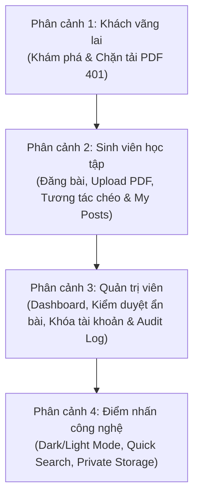

# KỊCH BẢN DEMO & BẢO VỆ ĐỒ ÁN — MINI STUDY NETWORK

> **Hệ thống:** Mạng xã hội học tập & Chia sẻ tài liệu học tập sinh viên (Mini Study Network)  
> **Công nghệ:** React 18, Vite, Tailwind CSS, Express.js, Sequelize ORM, MySQL 8, Playwright  
> **Thời lượng demo khuyến nghị:** 10 – 15 phút

---

## I. CHUẨN BỊ TRƯỚC BUỔI DEMO (SETUP & PREPARATION)

### 1. Khởi động hệ thống
Mở 2 cửa sổ terminal tại thư mục gốc của dự án:
* **Terminal 1 (Backend):**
  ```bash
  cd server && npm start
  # Đảm bảo hiển thị: 🚀 Server running on http://localhost:5000 | ✅ MySQL connected successfully.
  ```
* **Terminal 2 (Frontend):**
  ```bash
  cd client && npm run dev
  # Đảm bảo hiển thị: ➜ Local: http://localhost:5173/
  ```

### 2. Danh sách tài khoản thử nghiệm (Test Personas)
Chuẩn bị sẵn 3 tài khoản đại diện cho 3 vai trò:

| Vai trò | Email đăng nhập | Mật khẩu | Mục đích demo |
| :--- | :--- | :--- | :--- |
| **Quản trị viên (Admin)** | `admin@studynet.vn` | `Admin@123` | Quản lý hệ thống, kiểm duyệt nội dung, khóa/mở khóa tài khoản, xem audit log |
| **Sinh viên 1 (Student A)** | `hungnd13112004@gmail.com` | `123456` | Đăng câu hỏi, đăng tài liệu PDF, quản lý bài viết của tôi, sửa thông tin |
| **Sinh viên 2 (Student B)** | `demo1@gmail.com` | `Password123!` | Tương tác chéo: Like, bình luận bài viết, tải tài liệu PDF |
| **Khách vãng lai (Guest)** | *(Không đăng nhập)* | *(Không)* | Khám phá trang chủ, tìm kiếm, thử tải file bị chặn đăng nhập |

### 3. Thiết lập cửa sổ trình duyệt (Browser Setup)
* **Cửa sổ 1 (Trình duyệt thường):** Dùng để đăng nhập **Sinh viên A** và chuyển đổi sang **Quản trị viên**.
* **Cửa sổ 2 (Trình duyệt ẩn danh - Incognito):** Ban đầu để làm **Khách (Guest)**, sau đó đăng nhập **Sinh viên B** để biểu diễn tương tác chéo thời gian thực giữa 2 người dùng.

---

## II. KỊCH BẢN PHÂN CẢNH DEMO (SCENE-BY-SCENE WALKTHROUGH)



---

### PHÂN CẢNH 1: TRẢI NGHIỆM KHÁCH VÃNG LAI & RÀO CẮN BẢO MẬT (GUEST EXPERIENCE)
* **Thời lượng:** ~2 phút  
* **Môi trường:** Cửa sổ Ẩn danh (chưa đăng nhập)  
* **Mục tiêu:** Chứng minh hệ thống cho phép sinh viên tiếp cận tri thức mở nhưng bảo vệ chặt chẽ tài nguyên tải về (Chính sách ADR-011).

1. **Khám phá Bảng tin:**
   * Mở `http://localhost:5173/`.
   * Giới thiệu giao diện phong cách Bento Academic, hiển thị các bài viết câu hỏi, thảo luận và tài liệu học tập.
   * Thử chuyển qua các tab bộ lọc: *Hỏi đáp, Thảo luận, Tài liệu*.
2. **Tìm kiếm học thuật:**
   * Gõ phím tắt `/` hoặc bấm vào thanh tìm kiếm, gõ từ khóa `React` hoặc `Web` để tìm kiếm tài liệu.
3. **Chứng minh rào chắn tải PDF (Security Gate):**
   * Bấm vào xem chi tiết một tài liệu (ví dụ: *"Bộ tài liệu tổng hợp Fullstack Web"*).
   * Khách xem được đầy đủ: Tiêu đề, mô tả tóm tắt, tên môn học, tác giả và dung lượng file PDF.
   * **Thao tác quan trọng:** Bấm nút **"Tải tài liệu PDF"**.
   * **Kết quả quan sát:** Hệ thống hiển thị thông báo yêu cầu đăng nhập (HTTP 401 được bắt và thông báo toast / chuyển hướng sang `/login`). Không bao giờ rò rỉ URL file trực tiếp ra bên ngoài.

---

### PHÂN CẢNH 2: SINH VIÊN HỌC TẬP & CHIA SẺ TÀI LIỆU (SOCIAL LEARNING)
* **Thời lượng:** ~5 phút  
* **Môi trường:** Cửa sổ 1 (Sinh viên A) + Cửa sổ 2 (Sinh viên B)  
* **Mục tiêu:** Demo trọn vẹn vòng đời một bài viết từ đăng tải, upload PDF, tương tác chéo, đến quản lý cá nhân.

1. **Sinh viên A đăng tải bài viết & Upload PDF:**
   * Tại Cửa sổ 1, đăng nhập với `hungnd13112004@gmail.com` / `123456`.
   * Bấm nút **"Tạo bài viết"** (`/posts/create`).
   * Chọn loại bài: **Chia sẻ tài liệu**.
   * Nhập tiêu đề: *"Đề cương ôn tập & Bài tập thực hành Mạng máy tính 2026"*.
   * Nhập nội dung mô tả, chọn môn học *"Mạng máy tính"*.
   * **Upload file PDF:** Chọn một file PDF thực tế (≤10 MB).
   * Bấm **"Đăng bài"**: Hệ thống validate magic bytes `%PDF-`, mã hóa lưu file vào vùng lưu trữ riêng tư (Private Storage) và tạo bài viết với trạng thái `active` ngay lập tức.
2. **Sinh viên B tương tác chéo (Cửa sổ Ẩn danh):**
   * Đăng nhập tài khoản Sinh viên B (`demo1@gmail.com` / `Password123!`).
   * Vào trang chủ sẽ thấy ngay bài viết vừa đăng của Sinh viên A.
   * **Tải tài liệu PDF:** Bấm vào chi tiết bài viết và bấm **"Tải tài liệu PDF"** -> File PDF được tải về máy thành công với tên chuẩn an toàn.
   * **Tương tác:**
     * Bấm **Like** bài viết (chỉ số like tăng tức thời).
     * Bấm **Lưu bài viết (Bookmark)**.
     * Nhập bình luận: *"Cảm ơn bạn đã chia sẻ tài liệu rất hữu ích!"* và gửi (bình luận xuất hiện ngay lập tức).
3. **Sinh viên A quản lý bài viết của tôi (`/my-posts`):**
   * Quay lại Cửa sổ 1 của Sinh viên A, truy cập vào menu avatar -> chọn **"Bài viết của tôi"** (`/my-posts`).
   * Giới thiệu các tính năng mới tích hợp:
     * Bộ chỉ số thống kê bài viết, tổng lượt thích, bình luận.
     * Dropdown lọc theo trạng thái: *Đang hiển thị, Bị ẩn, Đã xóa*.
     * Sắp xếp theo: *Mới nhất, Nhiều tương tác nhất*.
   * Thử bấm chỉnh sửa bài viết hoặc thử chức năng xóa mềm.

---

### PHÂN CẢNH 3: QUẢN TRỊ VIÊN HỆ THỐNG & KIỂM DUYỆT (ADMIN MODERATION)
* **Thời lượng:** ~5 phút  
* **Môi trường:** Cửa sổ 1 (Chuyển sang tài khoản Admin)  
* **Mục tiêu:** Điểm nhấn thuyết phục nhất của đồ án — chứng minh hệ thống có công cụ quản trị kiểm duyệt chặt chẽ, truy vết minh bạch (Audited) và phản ứng bảo mật thời gian thực.

1. **Đăng nhập Quản trị viên & Tổng quan hệ thống:**
   * Đăng xuất Sinh viên A, đăng nhập Admin: `admin@studynet.vn` / `Admin@123`.
   * Giao diện Admin xuất hiện với thanh điều hướng 5 phân hệ:
     * **Tổng quan (`/admin`):** Biểu đồ xu hướng hoạt động, tổng bài viết, tổng người dùng.
     * **Phân tích (`/admin/analytics`):** Xếp hạng bài viết nổi bật và mức độ tương tác.
2. **Kiểm duyệt bài viết vi phạm (ADM-01):**
   * Vào **"Quản lý bài viết"** (`/admin/posts`).
   * Tìm bài viết của Sinh viên A vừa đăng.
   * Bấm nút **"Ẩn bài viết"**.
   * Hệ thống yêu cầu nhập lý do kiểm duyệt: Nhập *"Nội dung tài liệu cần xác minh bản quyền học phần"*.
   * Bấm **"Xác nhận ẩn"**.
   * **Kiểm chứng tức thời bên Sinh viên B:**
     * Chuyển sang Cửa sổ 2 (Sinh viên B), refresh trang chủ: Bài viết **hoàn toàn biến mất** khỏi bảng tin công khai.
     * Thử truy cập thẳng link cũ của bài viết: Trả về **404 Không tìm thấy**.
   * **Kiểm chứng bên tác giả (Sinh viên A):**
     * Đăng nhập lại Sinh viên A vào `/my-posts`: Bài viết chuyển sang tab **"Bị ẩn"** với thẻ trạng thái thông báo tĩnh, vô hiệu hóa các nút like/comment.
3. **Kiểm duyệt tài khoản người dùng (ADM-02):**
   * Quay lại giao diện Admin, chọn tab **"Tài khoản người dùng"** (`/admin/users`).
   * Danh sách hiển thị toàn bộ tài khoản với badge *Đang hoạt động / Đã khóa*.
   * **Điểm nhấn bảo mật:** Chỉ vào tài khoản `admin@studynet.vn` — Nút "Khóa" bị mờ và vô hiệu hóa (`disabled`) để **chống Admin tự khóa chính mình**.
   * Tìm tài khoản sinh viên vi phạm (ví dụ `demo4@gmail.com` hoặc tài khoản Sinh viên A).
   * Bấm nút **"Khóa"**: Modal bật lên yêu cầu nhập lý do (5–500 ký tự).
   * Nhập: *"Vi phạm chính sách chia sẻ tài liệu nhiều lần"*.
   * Bấm **"Xác nhận khóa"**.
   * **Kiểm chứng thu hồi phiên tức thời (Session Revocation):**
     * Người dùng bị khóa lập tức bị hủy bỏ toàn bộ refresh token trong database.
     * Mọi request tiếp theo (kể cả khi JWT access token chưa hết hạn) đều bị chặn **401/403**.
     * Khi người dùng cố đăng nhập lại: Hệ thống báo lỗi rõ ràng *"Tài khoản đã bị khóa"*.
   * **Mở khóa tài khoản:** Admin có thể bấm nút **"Mở khóa"** kèm lý do giải trình để phục hồi tài khoản cho sinh viên.
4. **Nhật ký kiểm duyệt minh bạch (Audit Logs):**
   * Vào tab **"Nhật ký kiểm duyệt"** (`/admin/audit-logs`) và phần audit trong trang `/admin/users`.
   * Chứng minh hệ thống ghi nhận đầy đủ:
     * Thời gian thao tác (chính xác đến mili-giây).
     * Admin thực hiện (Actor Admin ID).
     * Đối tượng bị xử lý (Target ID).
     * Trạng thái cũ → Trạng thái mới.
     * Lý do xử lý bắt buộc.
     * Dữ liệu là **Append-only** (không ai có thể chỉnh sửa hay xóa lịch sử audit).

---

### PHÂN CẢNH 4: ĐIỂM NHẤN CÔNG NGHỆ & TRẢI NGHIỆM (TECH HIGHLIGHTS)
* **Thời lượng:** ~2 phút  
* **Mục tiêu:** Gây ấn tượng về độ hoàn thiện UI/UX và tiêu chuẩn mã nguồn.

1. **Giao diện 2 chế độ Sáng / Tối (Light / Dark Theme):**
   * Bấm nút icon Mặt trời / Mặt trăng trên thanh điều hướng.
   * Toàn bộ hệ thống chuyển đổi màu sắc mượt mà, độ tương phản chuẩn WCAG, không chói mắt.
2. **Bộ nhận diện Mascot Cú học thuật (Academic Owl):**
   * Giới thiệu các trạng thái cảm xúc của Mascot: Khi không có dữ liệu tìm kiếm (Empty State), khi chào mừng, khi tải trang.
3. **Responsive Design:**
   * Bật Inspect chế độ Mobile/Tablet (iPhone 14 / iPad) trên DevTools để chứng minh giao diện co giãn linh hoạt, menu chuyển sang dạng trượt mượt mà.

---

## III. CẨM NANG TRẢ LỜI CÂU HỎI PHẢN BIỆN (DEFENSE Q&A GUIDE)

Dưới đây là các câu hỏi trọng tâm mà giảng viên / hội đồng chấm đồ án hay hỏi và câu trả lời chuẩn xác:

### 1. "File PDF lưu ở đâu? Có bị rò rỉ nếu ai đó đoán được URL không?"
* **Trả lời:**
  * File PDF không lưu ở thư mục public tĩnh (`/uploads`) mà được quản lý qua dịch vụ **Private Document Storage** riêng biệt.
  * Mỗi file khi tải lên được đổi tên thành mã UUID ngẫu nhiên và lưu ở thư mục bảo mật với quyền đọc hạn chế.
  * Khi người dùng tải file, bắt buộc phải đi qua endpoint API `/api/documents/:id/download` có middleware xác thực JWT và kiểm tra trạng thái bài viết (`active`).
  * Backend đọc file dạng stream và truyền về response chứ **không bao giờ trả về URL tĩnh**, do đó kẻ tấn công không thể dùng URL để tải lén.

### 2. "Nếu tài khoản bị Admin khóa nhưng Access Token của họ vẫn còn hạn (15 phút) thì họ có tiếp tục phá hoại được không?"
* **Trả lời:**
  * Hệ thống đã giải quyết triệt để vấn đề này. Middleware xác thực `auth.middleware.js` không chỉ giải mã chữ ký JWT mà còn truy vấn trường `is_active` của người dùng trên từng request.
  * Đồng thời, trong transaction khóa tài khoản, toàn bộ Refresh Token của tài khoản đó bị xóa (Revoke) ngay lập tức.
  * Vì vậy, ngay sau khi Admin bấm Khóa, người dùng đó gửi bất kỳ request nào cũng sẽ bị từ chối **401 Unauthorized** và không thể xin cấp token mới.

### 3. "Nếu có 2 Admin cùng thao tác khóa/mở khóa một tài khoản cùng lúc thì hệ thống xử lý thế nào?"
* **Trả lời:**
  * Endpoint `PATCH /api/admin/users/:id/status` được bọc hoàn toàn trong **Database Transaction** với cơ chế khóa dòng (Row-level Lock).
  * Trạng thái được kiểm tra điều kiện (CAS - Compare And Swap). Nếu trạng thái không thay đổi, hệ thống là idempotent và không tạo audit log dư thừa.
  * Thao tác ghi audit log được liên kết trong cùng transaction; nếu ghi log lỗi, toàn bộ thao tác cập nhật trạng thái sẽ tự động **Rollback** để bảo đảm toàn vẹn dữ liệu.

### 4. "Dự án có những bài kiểm thử tự động (Automated Tests) nào?"
* **Trả lời:**
  * Hệ thống có hệ thống test tự động nhiều tầng:
    1. **Unit & Contract Tests:** Kiểm tra tính toàn vẹn DTO, không lộ mật khẩu, không lộ private storage key.
    2. **Integration Regression Tests:** Hơn 10 kịch bản test trên MySQL 8 thật (chạy trong GitHub Actions CI và local): Test xác thực 2 tài khoản, test vòng đời refresh token, test kiểm duyệt bài viết BE-08, test kiểm duyệt tài khoản ADM-02, test phân trang BE-11.
    3. **E2E UI Tests:** Sử dụng Playwright điều khiển trình duyệt Chromium chụp màn hình và kiểm tra 0 console error, 0 broken images trên cả 2 theme Light và Dark.

### 5. "Phần thanh toán VNPay trong đồ án hiện tại thế nào?"
* **Trả lời:**
  * Theo quyết định phạm vi MVP (Option B trong `docs/MVP_SCOPE.md`), nhóm tập trung ưu tiên hoàn thiện xuất sắc trải nghiệm mạng xã hội học tập và chia sẻ tài liệu **hoàn toàn miễn phí** cho sinh viên.
  * Các route thanh toán cũ đã được khóa an toàn ở tầng backend (trả về 404/disabled có test negative) để tránh rò rỉ bảo mật. Nhóm đã thiết kế sẵn mô hình dữ liệu để sẵn sàng mở rộng tính năng tài liệu có phí và VNPay Sandbox trong giai đoạn tiếp theo.

---

## IV. BẢNG PHÂN CÔNG THUYẾT TRÌNH CỦA 2 THÀNH VIÊN (PROPOSED 2-PERSON DIVISION)

| Thành viên | Vai trò phụ trách | Nội dung thuyết minh trong buổi bảo vệ |
| :--- | :--- | :--- |
| **Thành viên A (Backend & Bảo mật)** | Trình bày Kiến trúc & Cơ sở dữ liệu | • Giới thiệu mô hình kiến trúc Client-Server, ERD cơ sở dữ liệu.<br>• Phân tích cơ chế bảo mật JWT, atomic refresh token, private PDF storage.<br>• Thuyết minh phân cảnh Quản trị viên (Khóa tài khoản, ẩn bài, Audit logs). |
| **Thành viên B (Frontend & Nghiệp vụ)** | Trình bày Giao diện & Luồng người dùng | • Giới thiệu ý tưởng sản phẩm, phân tích yêu cầu (Use Cases).<br>• Trực tiếp điều khiển thao tác Demo màn 1 (Khách) và màn 2 (Sinh viên tương tác chéo).<br>• Trình bày thiết kế Bento UI, Dark/Light mode và trải nghiệm người dùng. |
